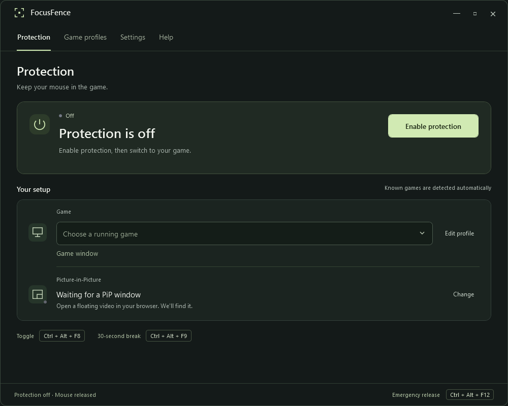

# FocusFence

A native Windows utility that keeps the mouse in your game and lets clicks pass through a Picture-in-Picture video. Built with **.NET 10**, with a completely English interface.

[Download the portable ZIP](https://github.com/ZazaJr24/FocusFence/releases/latest/download/FocusFence-Portable.zip) · [Releases](https://github.com/ZazaJr24/FocusFence/releases) · [Deutsche Anleitung](README.de.md)



## Why it exists

Watching a video while playing is convenient until a click on the floating player takes focus away from the game. FocusFence confines the pointer while the selected game is active and can make the PiP player click-through during that time. Alt+Tab releases both so you can use the rest of your desktop normally.

## Get started

The portable release is **self-contained, Windows x64**: the .NET 10 desktop runtime is included, so no separate .NET installation is needed. Windows 11 is recommended. For older Windows editions, see Microsoft's [supported Windows versions](https://learn.microsoft.com/en-us/dotnet/core/install/windows#supported-versions).

1. Download and extract the ZIP, then run `FocusFence.exe`. No installer is needed.
2. Open a browser video in Picture-in-Picture. FocusFence looks for its window automatically.
3. Click **Enable protection** and switch to your game. Known games are selected automatically. Other games can be selected directly in the **Game** field; a profile is saved automatically.
4. Use **Alt+Tab** to switch away. The mouse and video controls become available again.

The app always starts with protection off. Close the tray app via **Quit** to exit completely. Settings from the original .NET Framework version are retained.

**Emergency release: Ctrl+Alt+F12.** Ctrl+Alt+F8 toggles protection, and Ctrl+Alt+F9 pauses it for 30 seconds. The first two shortcuts are configurable.

## Features

- Redesigned interface with custom controls, a clear protection state, connected game/video setup and visible keyboard shortcuts.
- Automatic detection of typical browser PiP windows, including reacquisition after a browser restart.
- Known-game detection and saved per-game profiles.
- Window or monitor confinement, adjustable edge inset, DPI and multi-monitor support.
- PiP click-through only while the game is active.
- Manual window selection when automatic detection is ambiguous or unavailable.
- Tray controls, optional startup, profile import/export and local settings.
- A separate recovery companion that attempts to restore owned cursor and PiP changes after an unexpected process exit.

Settings and logs stay in `%LOCALAPPDATA%\FocusFence`. Detection does not require network access. There is no account or telemetry integration.

## Detection and compatibility

PiP detection is a heuristic based on browser process, native window class, title and window features. It recognizes typical Firefox, Chrome, Edge and other Chromium-based PiP windows, including several localized titles. It does not treat an ordinary browser tab as PiP just because its title mentions the feature. If several videos are open, it retains the current choice or asks you to select one under **Change**. Manual choices take priority over background discovery.

Not every browser implementation or game permits window changes. Borderless/windowed games are the intended use case. Higher-privilege or protected windows can reject access. Test your game/browser combination before an important session.

FocusFence uses Windows APIs; it does not inject code or read game memory. This is not a guarantee of compatibility with every anti-cheat system. The game's rules still apply.

The downloadable executable is currently **unsigned**. Source code, build instructions and release checksums are available so you can inspect it or build it yourself. Do not disable Windows security protections to run software you do not trust.

## Build

Install the **.NET 10 SDK** on Windows. There are no third-party NuGet dependencies; the SDK retrieves Microsoft's reference/runtime packs on the first build. The project uses `net10.0-windows` with WPF and a WinForms tray icon.

```powershell
.\build.ps1
.\build.ps1 -CoreTest
```

For the complete UI/native checks, exit any running FocusFence instance first:

```powershell
.\build.ps1 -Test
```

CI runs the build and headless core checks. Local integration checks also cover WPF controls, real PiP style changes, hotkey registration and crash recovery. Foreground and cursor operations are substituted during state-transition tests so the tests do not take over your pointer. These checks do not replace testing every real game/browser pair.

The output is a self-contained, compressed single-file executable in `dist-net10`. WPF is not trimmed. The SDK is pinned to stable .NET 10 by `global.json`.

To render the interface without enabling protection:

```powershell
.\dist-net10\FocusFence.exe --render preview.png
```

## Feedback

[Report a bug](https://github.com/ZazaJr24/FocusFence/issues/new/choose) with your Windows version, browser version, game if relevant, and steps to reproduce. Please remove private information from screenshots and logs. See [CONTRIBUTING.md](CONTRIBUTING.md).

The project was developed with AI assistance. Feature and compatibility claims are limited to the implementation and checks described above.

## License

[MIT](LICENSE).
